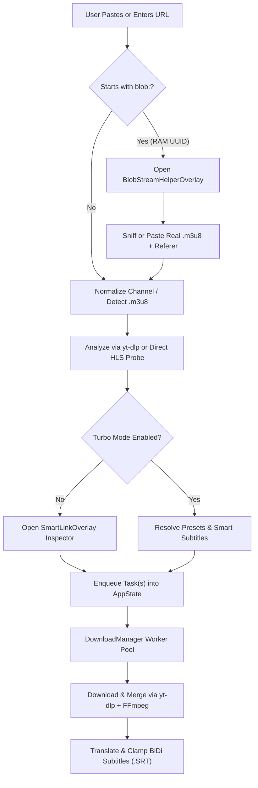
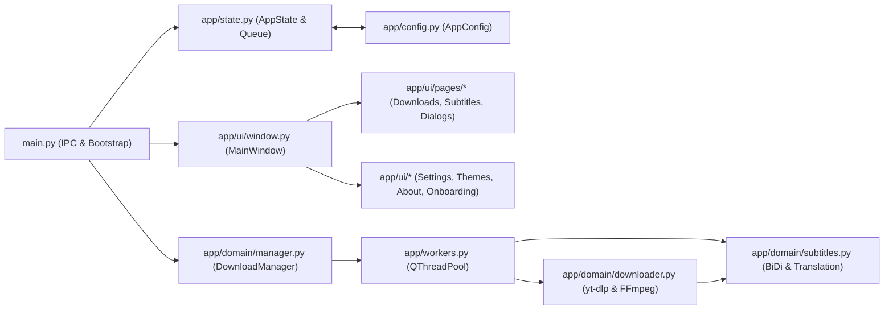

<div align="center">
  

  # V-Stream Downloader

  **A cross-platform desktop video, playlist, channel, and HLS/m3u8 downloader with non-overlapping RTL/LTR BiDi subtitle translation, multi-language audio selection, and SHA-256 verified self-updating engines.**

  
  
  -10B981)
  
  

  <!-- Uncomment after placing hero-downloads-ar-dark.png in docs/screenshots/ (see docs/screenshots/README.md) -->
  <!--  -->
</div>

## Table of Contents

- [Highlights](#highlights)
- [Screenshots](#screenshots)
- [Features in Detail](#features-in-detail)
- [Quick Start](#quick-start)
- [Build a Standalone Application](#build-a-standalone-application)
- [Using the App](#using-the-app)
- [Configuration Reference](#configuration-reference)
- [How It Works](#how-it-works)
- [Architecture](#architecture)
- [Design System](#design-system)
- [Testing](#testing)
- [Troubleshooting](#troubleshooting)
- [Privacy and Network Use](#privacy-and-network-use)
- [Known Limitations](#known-limitations)
- [Releasing](#releasing)
- [Contributing](#contributing)
- [Credits and Licenses](#credits-and-licenses)
- [Author](#author)

## Highlights

- **Real stream and dub-track inspection before downloading:** Probes actual media formats via [`yt-dlp`](https://github.com/yt-dlp/yt-dlp) (`4320p` 8K down to `144p`, FPS, estimated size, and multi-language audio dub tracks) and lets you cap playlist resolution or select ranges such as `1-10, 15, 20-25`.
- **Non-overlapping BiDi subtitle translation and sync:** Reconstructs fragmented YouTube auto-captions, translates cues contextually, enforces a `40 ms`–`45 ms` inter-cue gap so consecutive lines never stack on screen, and applies Smart-TV-safe Unicode `RLM`/`LRM` directional marks.
- **Persistent queues with debounced disk writes:** Saves active downloads, completed history, and batch Subtitle Studio jobs to `queue_state.json` via a `1000 ms` debounced timer, restoring in-progress tasks as paused on restart and auto-resuming queued tasks.
- **Cryptographically verified self-updating engines:** Checks and updates [`yt-dlp`](https://pypi.org/project/yt-dlp/) and [`yt-dlp-ejs`](https://pypi.org/project/yt-dlp-ejs/) wheels from PyPI after verifying their `SHA-256` digests, and auto-installs [`FFmpeg`](https://ffmpeg.org/) only when missing.
- **Browser in-memory `blob:` stream assistant:** Detects un-downloadable `blob:https://...` MediaSource UUID pointers, pre-fills the origin `Referer` header, and guides you through grabbing or sniffing the underlying `.m3u8` manifest in 3 steps.
- **13 UI languages with instant RTL/LTR mirroring:** Switches the entire interface—including settings descriptions, analyzer dialogs, context menus, and 32 color palettes—across 13 languages (`ar`, `en`, `es`, `fr`, `de`, `ru`, `tr`, `ur`, `fa`, `id`, `ms`, `bn`, `el`) without restarting.
- **Safe power management and single-instance IPC:** Guards post-queue actions (`quit_app`, `sleep`, `shutdown`) behind a one-shot session policy and a 60-second cancellable countdown dialog, while `QLockFile` + `QLocalServer` prevent duplicate app instances.

## Screenshots

> Screenshot links below are commented out until image files are captured into [`docs/screenshots/`](docs/screenshots/README.md) from a live desktop session (`1180 × 760` window size) in both RTL (Arabic Dark Mode) and LTR (English Light Mode).

| Arabic (RTL) · Dark Mode (`Cyber Violet`) | English (LTR) · Light Mode |
| :---: | :---: |
| <!--  --> *`docs/screenshots/hero-downloads-ar-dark.png`* | <!--  --> *`docs/screenshots/downloads-en-light.png`* |
| **Downloads view with active playlist cards and top command bar (RTL Dark)** | **Downloads view with 8-card service showcase and top command bar (LTR Light)** |
| <!--  --> *`docs/screenshots/smart-inspector-dialog.png`* | <!--  --> *`docs/screenshots/subtitle-studio-queue.png`* |
| **Smart Media, Audio Track & Subtitle Inspector (`SmartLinkOverlay`)** | **Persistent Subtitle Studio (`SubtitleStudioPage`) with batch `.srt`/`.vtt` jobs** |
| <!--  --> *`docs/screenshots/theme-palette-studio.png`* | <!--  --> *`docs/screenshots/about-diagnostics-modal.png`* |
| **Theme & Palette Studio (`32` handcrafted palettes + custom accent)** | **About & Diagnostics modal with live engine bar and open-source credits** |

<!-- Wide view for Settings Page -->
<!-- <div align="center"></div> -->

## Features in Detail

### Core Media & Stream Downloading

| Media Scope / Mode | When Triggered | Configurable Parameters | Limits & Edge-Case Handling |
| :--- | :--- | :--- | :--- |
| **Single Video (`single`)** | URL points to an individual video without a `list=` parameter (or user picks *Single Video Only*). | Resolution (`4320p`–`144p` or `best`), container (`mp4`, `mkv`, `webm`), audio dub language, subtitle track, translation target, BiDi fix. | Scope selection cards are hidden automatically when the URL is a standalone video. |
| **Full Playlist (`playlist`)** | URL contains a playlist (`list=...`, excluding YouTube Mix `RD...`) or `_type == "playlist"`. | Range filter (`1-10, 15, 20-25` or empty for all), quality ceiling (`Max Quality up to 1080p`), smart zero-padded numbering (`01 - ` or `001 - ` when `>= 100` items), dedicated subfolder. | Flat extraction probes up to `300` entries (`playlistend: 300`); concurrent worker pool runs `1`–`10` items in parallel (default `3`). |
| **Full Channel (`channel`)** | URL path contains `/@`, `/channel/`, `/c/`, or `/user/`. | Same range, quality ceiling, smart numbering, and subfolder controls as playlists. | Bare channel URLs automatically normalize to `/videos` (`normalize_channel_url`) and flatten nested tab entries. |
| **Live / VOD Stream (`m3u8`)** | URL ends with `.m3u8`, contains `.m3u8`, or webpage sniffing (`sniff_m3u8_from_webpage`) extracts an HLS manifest. | Resolution tier parsed from `#EXT-X-STREAM-INF:RESOLUTION=...`, custom `Referer` / `Origin` headers. | `blob:https://...` URLs raise `BlobUrlDetectedError` and open `BlobStreamHelperOverlay` with the origin domain pre-filled. |
| **Audio Only (`audio`)** | User selects *Audio Only* in the inspector or sets default quality to `audio_only`. | Bitrate (`320k`, `256k`, `192k`, `128k`, `64k`), format (`mp3`, `m4a`, `flac`, `wav`, `ogg`), audio dub track, cover thumbnail & metadata embedding. | Requires `FFmpeg` for `FFmpegExtractAudio` conversion and cover art embedding (`mp3`, `m4a`, `flac`). |
| **Subtitles Only (`subtitles_only`)** | User selects *Subtitles Only (.SRT)* in the inspector for a single video or an entire playlist. | Source track (manual or auto-generated), target translation language (`32` languages), BiDi fix, TV-safe mode. | Skips media stream download (`skip_download=True`) and outputs standalone `.srt` files named with smart playlist prefixes. |

### Smart Subtitles & Non-Overlapping BiDi Engine

- **Human vs. Auto-Caption Detection (`reconstruct_and_clamp_cues`):**
  - **Manual human subtitles (`is_auto_generated=False`):** Preserves translator cue boundaries and intentional short repeated utterances (such as `"No."` followed by `"No."`), while clamping overlapping timestamps so `cue[i].end_ms <= cue[i+1].start_ms - 40`.
  - **YouTube auto-generated captions (`is_auto_generated=True` or rolling overlap `>= 25%`):** Filters micro-transition cues (`< 130 ms` when the next cue starts within `50 ms`), strips rolling word suffixes repeated at the start of the next cue (`_remove_rolling_overlap`), merges fragmented clauses up to `84` characters or `6500 ms` duration (splitting on sentence punctuation `.?!؟。` or pauses `> 450 ms`), and enforces a `45 ms` gap before the next cue.
- **Balanced Two-Line Wrapping (`wrap_subtitle_lines_cleanly`):** Wraps cues longer than `54` characters at the word boundary closest to the midpoint so media players never render 3–4 stacked lines.
- **TV-Safe BiDi Formatting (`format_bidi_line`):**
  - When `tv_safe_bidi=True` (default), wraps lines in universal Unicode Right-to-Left / Left-to-Right Marks (`U+200F RLM` / `U+200E LRM`) and strips raw embedding controls (`U+202A`–`U+202C` and `U+2066`–`U+2069`) that render as missing-glyph boxes (`□`) on some Smart TVs and hardware receivers.
  - When `tv_safe_bidi=False`, wraps lines in full `RLM + RLE ... PDF + RLM` / `LRM + LRE ... PDF + LRM` directional embeddings.
- **Multi-Tier Translation Pipeline:**
  1. Attempts YouTube's native timedtext neural translation (`&tlang=<lang>`) when downloading directly from YouTube.
  2. Falls back to batched requests (`25` cues per batch, up to `1800` characters, `3` retries with exponential backoff) against `translate.googleapis.com`, then `clients5.google.com`, and finally `api.mymemory.translated.net`.
  3. Performs a single-cue retry pass for any cue that remained untranslated, and surfaces a warning count if any cues still fail.
- **Optional Video Container Muxing (`embed_subtitles_in_video`):** Muxes the synced `.srt` track into `.mp4` (`mov_text`) or `.mkv` (`srt`) alongside the external `.srt` file using `ffmpeg -map 0 -map 1:0 -c copy` so all video, multi-audio tracks, and chapters are preserved. Timeout scales dynamically with file size (`max(180, min(1800, int(120 + file_mb * 0.5)))` seconds).

### Interface, Localization & System Integration

| Feature Area | Behaviour | Configurable | Sound / Visual Feedback |
| :--- | :--- | :--- | :--- |
| **13 UI Languages & Instant RTL/LTR** | Switches layout direction (`Qt.RightToLeft` for `ar`, `fa`, `ur`; `Qt.LeftToRight` for `en`, `es`, `fr`, `de`, `ru`, `tr`, `id`, `ms`, `bn`, `el`) and translates all UI strings in place. | Top title bar language drop panel, Settings page, Tray menu, or First-Run Onboarding. | Bottom toast confirmation (`✓ <Language>`). |
| **32 Theme Palettes + Dark / Light / Auto** | Harmonizes background surfaces, accents, category badges (`single`, `m3u8`, `channel`), golden-angle multi-playlist colors, and the 3D V-Logo. | Title bar Dark/Light button, Themes page (`32` cards + custom color picker), Tray menu, or Onboarding. | Smooth crossfade when no modal is open; instant high-contrast refresh on open modals. |
| **Turbo One-Click Mode (`smart_mode_enabled`)** | Pasting or analyzing a link skips the inspector dialog and immediately enqueues the download using bar presets (Quality, Format, Subtitle language, Numbering). | Toggle switch + preset drop panels on the Downloads page command bar; playlist scope behavior in Settings. | Toast alert (`Turbo One-Click Download Started: <title>`). |
| **Smart Clipboard Monitor (`auto_paste_clipboard`)** | Watches `QGuiApplication.clipboard().dataChanged` for URLs matching YouTube, Vimeo, TikTok, Facebook, Twitch, SoundCloud, or `.m3u8` and starts analysis automatically. | Toggle switch in Settings (`General & Interface`). | Populates the URL bar and opens the inspector (or starts Turbo download). |
| **Scheduled Queue (`schedule_enabled`)** | Enqueues new tasks in `paused` state and starts them when `current_HH:MM >= schedule_time` and `last_schedule_run_date != today` (checked every `20 s`). | 24-hour `HH:MM` input + toggle in Settings (`default: 02:00`). | Toast alert showing scheduled start time. |
| **One-Shot Post-Queue Action (`post_queue_action`)** | Triggers `quit_app`, `sleep`, or `shutdown` once all active and queued downloads finish, then resets to `none`. | Drop panel in Settings (`none`, `quit_app`, `sleep`, `shutdown`). Never persisted as `shutdown` across restarts. | 60-second modal countdown (`PostQueueCountdownOverlay`) with `Cancel` (`Esc`) and `Execute Now`. |
| **Completion Notifications & Chime** | Shows a custom frameless bottom-right desktop popup (`NotificationPopup`) with click-to-reveal folder support and plays a synthesized two-tone WAV chime (`880 Hz` → `1318.5 Hz`). | Separate toggles for popup notifications and sound chime in Settings and Tray menu. | Synthesized `0.28 s` PCM WAV (`cache/v_notify_chime.wav`) via lazy `QMediaPlayer`. |

## Quick Start

### Requirements

- **Python:** `3.10` or newer (tested on Python `3.11.2`).
- **FFmpeg:** Optional at install time; required for `1080p`/`4K`/`8K` video+audio stream merging, audio extraction (`MP3`/`FLAC`/`M4A`), thumbnail cover art embedding, and subtitle muxing. You can install it with **1 click** inside the app (`Settings -> Auto-Install FFmpeg`) or via your system package manager.
- **JavaScript Runtime (Recommended for YouTube):** [`Deno`](https://deno.com/) (enabled by default in `yt-dlp`), [`Node.js`](https://nodejs.org/), [`QuickJS`](https://bellard.org/quickjs/), or [`Bun`](https://bun.sh/) on `PATH` (or inside the app's `bin/` directory) to execute [`yt-dlp-ejs`](https://pypi.org/project/yt-dlp-ejs/) YouTube challenge solvers at full speed.

```text
# Runtime dependencies (requirements.txt)
PySide6>=6.6.0            # Qt6 GUI framework (Widgets, Gui, Core, Network, Multimedia)
yt-dlp[default]>=2025.11.12 # Core media extractor with default extras
yt-dlp-ejs>=0.3.0         # External JavaScript challenge solver scripts for YouTube
requests>=2.31.0          # HTTP client for m3u8 probing, thumbnails, subtitle APIs, and self-updater
PySocks>=1.7.1            # SOCKS5 proxy support for requests and yt-dlp
certifi>=2024.2.2         # Mozilla CA root certificates bundle

# Development & packaging dependencies (requirements-dev.txt)
pyinstaller>=6.3.0        # Standalone --onedir executable packager
pyflakes>=3.2.0           # Static linter for unused imports and undefined names
pytest>=8.0.0             # Optional test runner (standard unittest also supported)
```

### Windows

Open **PowerShell** in the project folder and run (always use `python -m pip` on Windows to avoid PATH mismatches):

```powershell
python -m venv .venv
.\.venv\Scripts\Activate.ps1
python -m pip install --upgrade pip
python -m pip install -r requirements.txt
python main.py
```

Or double-click **`run.bat`**, which automatically uses `.venv\Scripts\python.exe` if present or falls back to system `python`.

### Linux

Install the required Qt6 XCB/Wayland and FFmpeg system packages for your distribution first:

| Distribution | System Packages Command |
| :--- | :--- |
| **Ubuntu / Debian** | `sudo apt update && sudo apt install -y python3-venv python3-pip ffmpeg libegl1 libgl1 libxkbcommon-x11-0 libxcb-cursor0 libdbus-1-3` |
| **Fedora / RHEL** | `sudo dnf install -y python3 python3-pip ffmpeg mesa-libGL libxkbcommon-x11 xcb-util-cursor dbus-libs` |
| **Arch / Manjaro** | `sudo pacman -S --needed python python-pip ffmpeg libxkbcommon-x11 xcb-util-cursor` |

Then create a virtual environment and launch the app:

```bash
python3 -m venv .venv
source .venv/bin/activate
python -m pip install --upgrade pip
python -m pip install -r requirements.txt
./run.sh
```

- **Wayland & System Tray Notes:** On GNOME Wayland without the AppIndicator extension, system tray icons may be hidden; closing the window when `tray.isVisible()` is false exits cleanly instead of hiding to an invisible tray. If custom window positioning behaves differently under Wayland compositors, run with `QT_QPA_PLATFORM=xcb ./run.sh`.

### macOS

> **Label:** *Not tested on a physical macOS host; paths and Evermeet FFmpeg/ffprobe JSON API endpoints are implemented from specification.*

```bash
python3 -m venv .venv
source .venv/bin/activate
python -m pip install --upgrade pip
python -m pip install -r requirements.txt
python3 main.py
```

## Build a Standalone Application

`build_exe.py` packages the application using **PyInstaller** in `--onedir` mode and renames PyInstaller's default `_internal` folder to **`V-Stream-Engine`** (`--contents-directory V-Stream-Engine`). PyInstaller cannot cross-compile across operating systems; run `build_exe.py` on the target OS (Windows for `.exe`, Linux for ELF binary, macOS for `.app`).

### Build Command

```powershell
python -m pip install -r requirements-dev.txt
python build_exe.py
```

### PyInstaller Options Used by `build_exe.py`

| Flag | Value | Purpose |
| :--- | :--- | :--- |
| `--noconfirm` | *(flag)* | Overwrites previous `build/` and `dist/` directories without prompting. |
| `--clean` | *(flag)* | Cleans PyInstaller cache before building. |
| `--windowed` | *(flag)* | Suppresses the console window on Windows and macOS (`sys.stdout is None` is safely guarded in `main.py`). |
| `--onedir` | *(flag)* | Produces a fast-starting directory bundle that avoids `--onefile` temp-extraction delays and reduces antivirus false positives. |
| `--contents-directory` | `V-Stream-Engine` | Places all runtime DLLs, `.pyd` extensions, and `assets/` inside `V-Stream-Engine/` instead of `_internal/`. |
| `--name` | `V-Stream-Downloader` | Sets the output folder and executable name. |
| `--icon` | `assets/icon.ico` | Regenerates `assets/icon.png` (`41,272 bytes`) and multi-size `assets/icon.ico` (`74,239 bytes`, `256`–`16 px`) via `tools/make_icon.py` before embedding. |
| `--add-data` | `assets;assets` (`:` on POSIX) | Bundles `assets/icon.png`, `assets/icon.ico`, `assets/fonts/*.ttf` (`1.88 MB`), and `assets/fonts/OFL.txt`. |
| `--collect-all` | `yt_dlp` & `yt_dlp_ejs` | Bundles all `yt-dlp` extractors and `yt-dlp-ejs` JavaScript challenge solver scripts. |

### Resulting Folder Layout (`dist/V-Stream-Downloader/`)

```text
dist/
└── V-Stream-Downloader/
    ├── V-Stream-Downloader.exe          # Main launcher executable (or V-Stream-Downloader on Linux)
    └── V-Stream-Engine/                 # Custom runtime contents directory (resolved by app/paths.py)
        ├── assets/
        │   ├── icon.ico                 # 74 KB multi-resolution icon
        │   ├── icon.png                 # 41 KB 256x256 PNG icon
        │   └── fonts/                   # Bundled Noto Sans, Noto Sans Arabic, Noto Kufi Arabic + OFL.txt
        ├── PySide6/                     # Qt6 runtime libraries and plugins
        ├── yt_dlp/                      # Bundled yt-dlp package
        └── yt_dlp_ejs/                  # Bundled EJS solver package
```

### Packaging Tips & Windows Installer (`installer.iss`)

- **Output Size:** *Template note: PyInstaller `--onedir` output size with `PySide6` + `yt-dlp` is typically ~140–190 MB uncompressed (~55–75 MB when compressed with Inno Setup `lzma2/ultra64`); not measured in the sandbox VM because `PyInstaller` is not pre-installed in the offline container.*
- **Windows Installer (`installer.iss`):** Open `installer.iss` in [Inno Setup Compiler](https://jrsoftware.org/isinfo.php) (or run `iscc installer.iss`) after running `python build_exe.py` to produce `dist/V-Stream-Downloader-Pro-v5.1.0-Setup.exe`.
- **SmartScreen & Code Signing:** Unsigned Windows executables trigger Microsoft Defender SmartScreen warnings on first download. Sign both `V-Stream-Downloader.exe` and the Inno Setup output installer with `signtool.exe sign /fd SHA256 /tr http://timestamp.digicert.com /td SHA256` using an OV/EV code-signing certificate when distributing publicly.
- **Linux `glibc` Compatibility:** Build on the oldest target Linux distribution you intend to support (e.g., Ubuntu 20.04 / Debian 11) so the compiled bundle runs on newer `glibc` systems.
- **Windows Icon Cache:** If Windows Explorer caches an old icon after rebuilding, run `ie4uinit.exe -show` in PowerShell.

## Using the App

### First-Run Onboarding Wizard (`OnboardingOverlay`)

When `first_run_completed` is `False` in `config.json`, the 3-step setup modal opens automatically:

1. **Step 1 — Language & Layout:** Pick any of the 13 UI languages, choose **Dark**, **Light**, or **Auto** appearance mode, and optionally enable **Launch on Windows Startup**. All 3 onboarding steps and the main window behind the modal switch language, RTL/LTR layout direction, and theme colors immediately.
2. **Step 2 — Downloads & Smart Subtitles:** Choose your default download folder, toggle smart zero-padded playlist numbering (`01 - Title` / `001 - Title`), and toggle non-overlapping RTL/LTR BiDi subtitle formatting.
3. **Step 3 — Pick Your Signature Palette:** Choose from the 32 handcrafted color palettes and review the legal use notice before clicking **Launch V-Stream**.

### Main Screens

1. **Downloads (`DownloadsPage`):**
   - **Top Command Bar:** Paste a link (`Paste Link`), type or paste any media URL into the input box (right-click context menu supports **Paste & Analyze Immediately**), click **Analyze Link**, or click **Last Analysis** to reopen the most recent inspection dialog without re-fetching.
   - **Turbo One-Click Bar:** Toggle **Turbo One-Click Download Mode** and set quick bar presets for **Quality**, **Subtitles**, and **Numbering**.
   - **Filter Tabs & Batch Controls:** Filter queue cards by `All`, `Active`, `Playlists`, `Channels`, `Single / m3u8`, or `Completed`, Search by title/channel, or click `Pause All`, `Resume All`, or `Clear Done`.
2. **Subtitle Studio (`SubtitleStudioPage`):**
   - Select one or more local `.srt` or `.vtt` files for standalone batch translation and non-overlapping BiDi synchronization.
   - Jobs run in a dedicated background queue (up to `2` concurrent subtitle workers) and persist across tab switches and app restarts, displaying live cue counts (`done_cues / total_cues`), percentage progress, and output paths (`<name>.<lang>.synced.srt`).
3. **Themes & Palettes (`ThemesPage`):**
   - Switch between **Dark**, **Light**, and **Auto** (OS color scheme) modes, pick any of the **32 handcrafted palettes**, or click **Custom Accent...** to generate a custom HSL-harmonized palette from any hex color.
4. **Settings (`SettingsPage`):**

| Settings Card | What You Can Configure |
| :--- | :--- |
| **1. Core Engines & Self-Updater** | Check/auto-install `FFmpeg` (`verify_ffmpeg_working` avoids re-downloading if already working), browse a custom `ffmpeg` binary, check/update `yt-dlp` + `yt-dlp-ejs` (with `SHA-256` verification), copy a full technical diagnostics report, toggle external JS runtimes (`Deno`/`Node`/`QuickJS`/`Bun`), and toggle startup `yt-dlp` update checks. |
| **2. General & Interface** | Switch among 13 UI languages, toggle Smart Clipboard URL Monitor, desktop popup notifications, completion sound chime, minimize-to-tray on close, launch on Windows startup, 24h download scheduler (`HH:MM`), and one-shot post-queue action (`none`, `quit_app`, `sleep`, `shutdown`). |
| **3. Download Engine & Smart Numbering** | Choose default download folder, default quality (`best`, `2160p`..`360p`, `audio_only`), Turbo mode playlist scope (`ask`, `single`, `playlist`), output filename template (`{prefix}{title}`, `{prefix}{channel} - {title}`, `{prefix}{title} [{id}]`), max concurrent downloads (`1`–`10`), global speed limit (`Unlimited` or `512`–`10240 KB/s`), smart numbering, playlist subfolders, `download_archive.txt` log, auto-open folder on completion, auto-clean completed tasks (`0`, `1`, `3`, `7`, `30` days), thumbnail cover art, and media metadata/chapters. |
| **4. Cookies, Private Videos & Proxy** | Extract session cookies from a browser (`firefox` recommended, `chrome`, `edge`, `brave`, `opera`), browse an external Netscape `cookies.txt` file, or configure an `HTTP`/`SOCKS5` proxy URL (auto-saved as you type). |
| **5. Smart Subtitles & RTL/LTR BiDi Engine** | Choose default subtitle selection mode (`prefer_target_then_translate`, `always_translate`, `original_only`, `none`), preferred target language (`32` languages), fallback source language, YouTube auto-caption support, non-overlapping BiDi fix, Smart-TV-safe `RLM`/`LRM` mode, and subtitle track muxing into `.mp4`/`.mkv`. |

5. **About & Diagnostics (`AboutOverlay`):**
   - Displays current version, 4 feature chips, live engine status (`yt-dlp` version, `FFmpeg` status, detected JS runtime), **Copy Diagnostics** button, **Check Updates** button, developer contact cards, open-source license attributions, and legal notice. Press `Esc` or click outside the card to close.

### System Tray & Command-Line Flags

- **System Tray Menu:** Shows live active task count (`Status: Idle & Ready` or `Downloading N active item(s)`), **Open V-Stream**, **Toggle Notifications**, **Switch Theme (Dark / Light)**, **Interface Language** (13-language submenu), and **Quit V-Stream**.
- **Command-Line Arguments & Environment Variables:**
  - `main.py` forwards `sys.argv` to `QApplication(sys.argv)` (supporting standard Qt flags such as `-platform xcb` or `-style fusion`) and does not define custom CLI flags.
  - `APPDATA` (Windows) and `XDG_CONFIG_HOME` (Linux) control the base directory for application data (`app/paths.py`).

## Configuration Reference

### OS-Specific Data Locations (`app/paths.py`)

| Operating System | Application Data Directory (`app_data_dir()`) | Default Media Download Directory (`default_download_dir()`) |
| :--- | :--- | :--- |
| **Windows** | `%APPDATA%\VStreamDownloader\` (e.g. `C:\Users\<you>\AppData\Roaming\VStreamDownloader\`) | `C:\Users\<you>\Downloads\V-Stream\` |
| **Linux** | `$XDG_CONFIG_HOME/VStreamDownloader/` (defaults to `~/.config/VStreamDownloader/`) | `~/Downloads/V-Stream/` |
| **macOS** | `~/Library/Application Support/VStreamDownloader/` | `~/Downloads/V-Stream/` |

### Contents of the Application Data Directory

```text
VStreamDownloader/
├── config.json              # User configuration (schema_version = 6, atomic .tmp replacement)
├── queue_state.json         # Persisted download tasks, history, and Subtitle Studio jobs (version = 6)
├── download_archive.txt     # Optional yt-dlp archive log of previously downloaded video IDs
├── v_stream.lock            # QLockFile single-instance lock file
├── bin/
│   ├── ffmpeg(.exe)         # Auto-installed static FFmpeg binary (if installed via Settings)
│   ├── ffprobe(.exe)        # Auto-installed static FFprobe binary
│   └── yt_dlp_pkg/          # Self-updated yt_dlp and yt_dlp_ejs packages (prepended to sys.path)
├── cache/
│   ├── v_notify_chime.wav   # Synthesized 44.1 kHz 16-bit mono notification chime
│   └── thumbnails/          # Cached video thumbnails (<sha256_prefix_20>.jpg)
└── logs/
    └── v_stream.log         # Rotating application log (2 MB max per file, 3 backups)
```

### How to Reset Configuration or Trigger First-Run Onboarding

- **Full Reset:** Quit V-Stream Downloader and delete `config.json` (and optionally `queue_state.json`) inside the OS data directory above. On next launch, `AppConfig.load()` recreates `config.json` with factory defaults and opens the First-Run Onboarding wizard.
- **Re-open Onboarding Only:** Edit `config.json` and set `"first_run_completed": false`.

### Full `AppConfig` Key Reference (`app/config.py`)

<details>
<summary><strong>Click to expand all 38 configuration keys, defaults, and meanings (schema_version = 6)</strong></summary>

| Key | Type | Default | Meaning |
| :--- | :--- | :--- | :--- |
| `schema_version` | `int` | `6` | Config schema version used by `AppConfig._migrate()`. |
| `language` | `str` | `"ar"` | Active UI language code (`ar`, `en`, `es`, `fr`, `de`, `ru`, `tr`, `ur`, `fa`, `id`, `ms`, `bn`, `el`). |
| `theme_mode` | `str` | `"dark"` | Appearance mode (`"dark"`, `"light"`, or `"auto"`). |
| `palette_id` | `str` | `"cyber_violet"` | Active theme palette ID (`32` built-in IDs in `PALETTE_SPECS` or `"custom"`). |
| `custom_accent` | `str` | `"#8B5CF6"` | Hex color used when `palette_id` is `"custom"`. |
| `first_run_completed` | `bool` | `False` | Whether the 3-step `OnboardingOverlay` wizard has been completed. |
| `smart_mode_enabled` | `bool` | `False` | Enables Turbo One-Click Download Mode on the Downloads page. |
| `smart_mode_scope` | `str` | `"ask"` | Default playlist behavior in Turbo Mode (`"ask"`, `"single"`, `"playlist"`, `"channel"`). |
| `download_dir` | `str` | `~/Downloads/V-Stream` | Base directory where downloaded files and playlist subfolders are saved. |
| `max_concurrent_downloads` | `int` | `3` | Maximum parallel active media download workers (`1`–`10`). |
| `preferred_quality` | `str` | `"1080p"` | Default quality (`"best"`, `"4320p"`, `"2160p"`, `"1440p"`, `"1080p"`, `"720p"`, `"480p"`, `"360p"`, `"240p"`, `"144p"`, `"audio_only"`). |
| `preferred_video_format` | `str` | `"mp4"` | Default video container (`"mp4"`, `"mkv"`, `"webm"`). |
| `preferred_audio_format` | `str` | `"mp3"` | Default audio extraction format (`"mp3"`, `"m4a"`, `"flac"`, `"wav"`, `"ogg"`). |
| `smart_numbering` | `bool` | `True` | Prefixes playlist/channel files with `01 - ` (or `001 - ` when total `>= 100`). |
| `create_subfolder_for_playlists` | `bool` | `True` | Creates a dedicated sanitized subfolder per playlist or channel. |
| `filename_template` | `str` | `"{prefix}{title}"` | Output naming pattern (`"{prefix}{title}"`, `"{prefix}{channel} - {title}"`, `"{prefix}{title} [{id}]"`). |
| `embed_thumbnail` | `bool` | `True` | Embeds video thumbnail as cover art into `mp4`/`mkv`/`mp3`/`m4a`/`flac` via FFmpeg. |
| `embed_metadata` | `bool` | `True` | Embeds artist, title, and upload metadata via `FFmpegMetadata`. |
| `embed_chapters` | `bool` | `True` | Writes chapter markers into video containers via `FFmpegMetadata`. |
| `embed_subtitles_in_video` | `bool` | `False` | Muxes the synced `.srt` subtitle track into `.mp4`/`.mkv` in addition to saving the standalone `.srt` file. |
| `use_download_archive` | `bool` | `False` | Records downloaded video IDs in `download_archive.txt` and skips them in future sessions. |
| `prevent_duplicate_tasks` | `bool` | `True` | Blocks adding a URL + media mode that is already active/queued or completed (if the file still exists on disk). |
| `open_folder_on_complete` | `bool` | `False` | Opens the output directory in the OS file manager when a download completes. |
| `auto_cleanup_days` | `int` | `0` | Auto-removes completed/canceled task cards older than `N` days (`0` = keep until `max_history_items`). |
| `max_history_items` | `int` | `250` | Maximum completed/canceled tasks retained in `queue_state.json`. |
| `subtitle_mode` | `str` | `"prefer_target_then_translate"` | Default subtitle behavior (`"prefer_target_then_translate"`, `"always_translate"`, `"original_only"`, `"none"`). |
| `preferred_subtitle_lang` | `str` | `"ar"` | Target language code checked first on the video and used as translation destination. |
| `fallback_source_lang` | `str` | `"en"` | Source subtitle track language fetched when translating into `preferred_subtitle_lang`. |
| `allow_auto_generated_subs` | `bool` | `True` | Allows falling back to YouTube automatic captions when manual tracks are absent. |
| `translate_subtitles` | `bool` | `True` | Enables automatic subtitle translation into `preferred_subtitle_lang`. |
| `translate_target_lang` | `str` | `"ar"` | Default target language selected in Subtitle Studio. |
| `enforce_bidi_rtl_fix` | `bool` | `True` | Applies RTL/LTR BiDi directional formatting and balanced 2-line wrapping to subtitles. |
| `tv_safe_bidi` | `bool` | `True` | Uses universal `RLM`/`LRM` marks instead of `RLE`/`LRE`/`PDF` controls for Smart TV compatibility. |
| `cookies_browser` | `str` | `"none"` | Browser name for `cookiesfrombrowser` (`"none"`, `"firefox"`, `"chrome"`, `"edge"`, `"brave"`, `"opera"`). |
| `cookies_file_path` | `str` | `""` | Path to an external Netscape-format `cookies.txt` file (takes precedence over `cookies_browser`). |
| `proxy_url` | `str` | `""` | HTTP or SOCKS5 proxy URL passed to `yt-dlp` and `requests`. |
| `js_runtime_enabled` | `bool` | `True` | Passes detected JS runtimes (`deno`, `node`, `quickjs`, `bun`) in `js_runtimes` to `yt-dlp`. |
| `auto_update_ytdlp_on_startup` | `bool` | `False` | Silently checks PyPI for `yt-dlp` updates `2.5 s` after application startup. |
| `notifications_enabled` | `bool` | `True` | Enables bottom-right desktop popup notifications on task completion. |
| `sound_enabled` | `bool` | `True` | Enables the completion audio chime when `notifications_enabled` is active. |
| `minimize_to_tray` | `bool` | `True` | Minimizes the main window to the system tray on close instead of quitting. |
| `run_on_startup` | `bool` | `False` | Launches V-Stream Downloader automatically on Windows sign-in (or Linux XDG autostart). |
| `auto_paste_clipboard` | `bool` | `False` | Automatically analyzes supported media URLs copied to the system clipboard. |
| `ffmpeg_custom_path` | `str` | `""` | Custom file or folder path for `ffmpeg` (auto-populated when FFmpeg is installed via Settings). |
| `speed_limit_kbps` | `int` | `0` | Global bandwidth limit in KB/s shared evenly across active workers (`0` = unlimited). |
| `schedule_enabled` | `bool` | `False` | Enqueues new tasks as `paused` and starts them at `schedule_time`. |
| `schedule_time` | `str` | `"02:00"` | 24-hour `HH:MM` start time for scheduled downloads. |
| `last_schedule_run_date` | `str` | `""` | `YYYY-MM-DD` date stamp preventing duplicate schedule triggers on the same day. |
| `post_queue_action` | `str` | `"none"` | One-shot session action (`"none"`, `"quit_app"`, `"sleep"`, `"shutdown"`). Always saved to disk as `"none"`. |

</details>

### Configuration Migration Policy

`AppConfig.load()` reads `config.json`, merges missing keys from current dataclass defaults (`AppConfig._migrate()`), validates `preferred_quality`, forces `post_queue_action = "none"` on every startup, bumps `schema_version` to `6`, and writes atomically via `config.tmp` -> `config.json`. If `config.json` is corrupted JSON, it logs a warning and restores clean defaults.

## How It Works

### Domain Execution Flow



### Core Engine Behaviour Notes

- **Parallel Single + Playlist Probing:** When a YouTube URL contains both `v=<video_id>` and `list=<playlist_id>`, `analyze_media_url()` uses a 2-worker `ThreadPoolExecutor` (`22 s` timeout) to probe full format/subtitle metadata for the single video (`noplaylist=True`) concurrently with flat playlist metadata (`extract_flat="in_playlist"`), so the inspector opens quickly with both real video resolutions and the full playlist entry list.
- **Exact File Stem & `MAX_PATH` Safety:** `build_safe_output_stem()` computes the resolved target directory length and caps the filename stem so `target_dir / stem + .part.mp4` never exceeds `258` characters on Windows, while escaping Windows reserved device names (`CON`, `PRN`, `AUX`, `NUL`, `COM1`..`COM9`, `LPT1`..`LPT9`).
- **Collision-Proof Temp File Cleanup:** `_find_downloaded_files_safe()` and `cleanup_task_temp_files()` match `f.stem == file_stem` or `f.name.startswith(file_stem + ".")` instead of prefix-only matching, ensuring that cancelling `"Intro"` never deletes `"Intro 2.mp4"`.
- **Dynamic Per-Worker Bandwidth Sharing:** When `speed_limit_kbps > 0`, `DownloadManager._start_worker()` divides `speed_limit_kbps` evenly across `len(self._running_ids)` (with a `32 KB/s` floor per worker) and passes `ratelimit` in bytes/sec to `yt-dlp`.
- **Graceful Shutdown Protocol:** On exit (`app.aboutToQuit`), `DownloadManager.shutdown()` stops the scheduler timer, sets all running download and subtitle control flags to `"pause"`, marks active items as `"paused"` (preserving `.part` files for resumable `continuedl=True` downloads), flushes `queue_state.json` synchronously, and waits up to `3500 ms` (`wait_for_all_workers(3500)`) for worker threads to exit.

<details>
<summary><strong>Click to expand Supported Subtitle Languages (32 languages) & Format Selectors</strong></summary>

| Category | Supported Values in Code |
| :--- | :--- |
| **Video Resolution Tiers (`STANDARD_VIDEO_TIERS`)** | `4320p` (8K), `2160p` (4K), `1440p` (2K QHD), `1080p` (Full HD), `720p` (HD), `480p` (SD), `360p`, `240p`, `144p`, `best` (Auto Max). |
| **Video Containers** | `mp4`, `mkv`, `webm` |
| **Audio Bitrates & Formats** | Bitrates: `320k`, `256k`, `192k`, `128k`, `64k` · Formats: `mp3`, `m4a`, `flac`, `wav`, `ogg` |
| **Subtitle & Audio Languages (`LANGUAGE_NAMES_BY_LOCALE`)** | `ar` (Arabic), `en` (English), `es` (Spanish), `fr` (French), `de` (German), `ru` (Russian), `tr` (Turkish), `ur` (Urdu), `fa` (Persian), `id` (Indonesian), `ms` (Malay), `bn` (Bengali), `el` (Greek), `it` (Italian), `pt` (Portuguese), `zh` (Chinese), `ja` (Japanese), `ko` (Korean), `hi` (Hindi), `nl` (Dutch), `pl` (Polish), `uk` (Ukrainian), `vi` (Vietnamese), `th` (Thai), `sv` (Swedish), `ro` (Romanian), `hu` (Hungarian), `cs` (Czech), `da` (Danish), `fi` (Finnish), `no` (Norwegian), `he` (Hebrew). |

</details>

## Architecture



### Module Responsibility Table

| Path | Responsibility |
| :--- | :--- |
| `main.py` | Application entry point: configures `RotatingFileHandler` logging, acquires `QLockFile` + `QLocalServer` single-instance IPC, loads bundled `.ttf` fonts, initializes `AppConfig`, `AppState`, `DownloadManager`, and `MainWindow`. |
| `app/config.py` | `AppConfig` dataclass (`schema_version = 6`), atomic JSON persistence (`config.tmp` -> `config.json`), schema migration, and one-shot `post_queue_action` safety reset. |
| `app/paths.py` | Cross-platform path resolution (`app_data_dir`, `bin_dir`, `bundle_dir` supporting PyInstaller `V-Stream-Engine`, `logs_dir`, `thumbs_cache_dir`) and Windows Registry / Linux XDG autostart helpers. |
| `app/state.py` | Reactive Qt signal hub (`AppState`), `DownloadTaskItem`, `SubtitleJobItem`, and `AnalyzedMediaInfo` dataclasses, debounced `queue_state.json` persistence, history pruning, and file-aware duplicate detection. |
| `app/workers.py` | `AsyncTask(QRunnable)` and `run_async()` wrapper around `QThreadPool.globalInstance()` with `_ACTIVE_KEEPALIVE` reference retention and `wait_for_all_workers()` shutdown synchronization. |
| `app/domain/downloader.py` | URL normalization, `m3u8` sniffing, `yt-dlp` media probing & downloading, `js_runtimes` detection, `SHA-256` verified `yt-dlp` / `yt-dlp-ejs` / `FFmpeg` installers, safe zip/tar extraction, and diagnostics collection. |
| `app/domain/subtitles.py` | VTT/SRT/JSON3/TTML parser, rolling auto-caption overlap remover, timestamp clamping (`40`–`45 ms` gap), multi-provider batch translator (`Google` + `MyMemory`), and TV-safe `RLM`/`LRM` BiDi formatter. |
| `app/domain/manager.py` | `DownloadManager` orchestrating concurrent download workers, persistent Subtitle Studio workers, `_TaskSignalBridge` thread-to-UI marshaling, resilient 24h scheduler, and post-queue countdown triggers. |
| `app/i18n.py` & `app/i18n_catalog.py` | 13-language translation engine (`t()`, `tp()`, `tl()`, `force_ltr()`), diacritic-insensitive search normalization (`normalize_search_query`), and full phrase/regex catalog (`227` static phrases + `30` dynamic templates). |
| `app/theme.py` | HSL palette generator (`gen_palette`) producing dark and light token dictionaries across `32` built-in palettes (`PALETTE_SPECS`) plus custom accent support and golden-angle playlist color assignment. |
| `app/notifier.py` & `app/sound.py` | `NotifierEngine` bridging task completion signals to `NotificationPopup` and `SoundManager` (lazy `QMediaPlayer` + math-synthesized `v_notify_chime.wav`). |
| `app/ui/window.py` | Frameless custom-drawn `MainWindow`, `TitleBar`, hover-animated `FloatingSidebar`, `PostQueueCountdownOverlay`, system tray menu, and clipboard URL monitor. |
| `app/ui/widgets.py` | Custom QPainter widget library: `StyledLineEdit`, `Button`, `IconButton`, `ToggleSwitch`, `SegmentedControl`, `ScopeChoiceCard`, `SearchCombo` (searchable drop panel), `NumberInput`, `GlassCard`, `ToastOverlay`, `SlideStack`. |
| `app/ui/icons.py` | Procedural vector icon renderer (`draw_icon`, `make_qicon`) and theme-tinted 3D Ribbon V-Logo generator (`logo_pixmap`). |
| `app/ui/pages/downloads_page.py` | Main downloads view: URL command bar, Turbo One-Click preset bar, filter tabs, 8-card `ServiceHeroShowcase`, and custom-painted `DownloadItemCard` list. |
| `app/ui/pages/smart_link_dialog.py` | `SmartLinkOverlay` (scope cards, playlist range selector, quality/format/dub-track combos, subtitle inspector) and `BlobStreamHelperOverlay`. |
| `app/ui/pages/subtitle_studio_page.py` | Standalone batch `.srt`/`.vtt` translation and BiDi sync studio with live task summary pills and persistent job cards. |
| `app/ui/settings_page.py` | 5-card scrollable Settings interface with instant auto-save and live FFmpeg/`yt-dlp` status feedback. |
| `app/ui/themes_page.py` | Interactive grid of `PalettePreviewCard` widgets for all 32 color palettes, Dark/Light/Auto selector, and custom color dialog. |
| `app/ui/about_dialog.py` | `AboutOverlay` modal with synchronized banner/logo geometry, 4 feature chips, live engine status, one-click diagnostics copy, clickable email/WhatsApp rows, and open-source credits. |
| `app/ui/onboarding.py` | 3-step first-run setup wizard (`OnboardingOverlay`) with live language, RTL/LTR layout, and Dark/Light theme switching across all steps. |
| `tools/make_icon.py` & `build_exe.py` | Pure-Python PNG/ICO generator (`tools/make_icon.py`) and PyInstaller `--onedir` build script (`build_exe.py`). |

### Key Design Decisions

- **Thread-to-UI Marshaling via `_TaskSignalBridge`:** Worker functions run inside `QThreadPool` threads (`app/workers.py`) and never mutate `AppState` or Qt widgets directly; they emit typed Qt signals on `_TaskSignalBridge` so all state updates and UI repaints occur strictly on the main Qt GUI thread.
- **No `QGraphicsOpacityEffect` on Scrollable Pages (`SlideStack`):** Qt6's `QGraphicsOpacityEffect` on parent `QScrollArea` containers can break child `QLineEdit` cursor rendering and mouse hit-testing; `SlideStack` switches pages directly and clears graphics effects on active pages, while `StyledLineEdit` applies explicit theme stylesheets.
- **External `yt_dlp_pkg` Overlay (`bin/yt_dlp_pkg`):** Frozen PyInstaller executables normally cannot update bundled Python packages. By extracting verified PyPI wheels into `%APPDATA%\VStreamDownloader\bin\yt_dlp_pkg` and prepending that directory to `sys.path` (plus reloading `sys.modules["yt_dlp"]` via `importlib.util.spec_from_file_location`), users can update `yt-dlp` and `yt-dlp-ejs` in 1 click without reinstalling the application.

## Design System

- **Theme Tokens & 32 Palettes (`app/theme.py`):** Every palette is generated from a seed accent hex color via `gen_palette()`, computing matched `dark` and `light` token tables (`bg0`, `bg1`, `bg2`, `surface`, `surface_hi`, `border`, `border_hi`, `text`, `text2`, `text3`, `accent`, `accent2`, `accent_hi`, `on_accent`, `ok`, `warn`, `danger`, `glass`, `shadow`, `cat_single`, `cat_m3u8`, `cat_channel`). Concurrent playlists receive distinct golden-angle hues (`(base_hue + 48 + idx * 127) % 360`).
- **Typography (`app/ui/widgets.py`):** Bundled TrueType fonts in `assets/fonts/` (`NotoSans-Regular.ttf`, `NotoSans-Bold.ttf`, `NotoSansArabic-Regular.ttf`, `NotoSansArabic-Bold.ttf`, `NotoKufiArabic-Regular.ttf`, `NotoKufiArabic-Bold.ttf`) are registered at startup via `QFontDatabase.addApplicationFont`, with a multi-script fallback chain (`Tajawal`, `Noto Kufi Arabic`, `Noto Sans Arabic`, `Noto Nastaliq Urdu`, `Vazirmatn`, `Segoe UI`, `Nirmala UI`, `Noto Sans Bengali`, `Vrinda`, `Urdu Typesetting`, `Noto Sans`, `Calibri`, `Arial`).
- **Shapes, Cards & Motion:** Frameless main window (`20 px` corner radius, `10 px` multi-pass drop shadow margin), `GlassCard` containers (`opaque=True` on modal overlays to prevent background bleed-through), `170 ms`–`210 ms` `QEasingCurve.OutCubic` animations on `ToggleSwitch`, `SegmentedControl`, `Button`, and `FloatingSidebar` (`74 px` collapsed -> `216 px` expanded on hover).
- **Vector Iconography & 3D V-Logo (`app/ui/icons.py`):** All UI icons and the sculpted 3D ribbon V-Logo (`logo_pixmap`) are drawn procedurally with `QPainterPath` and `QLinearGradient`, recoloring dynamically whenever the user switches palettes.
- **BiDi & RTL/LTR Layout Mirroring (`app/i18n.py`):** `I18N.set_language()` sets `QApplication.setLayoutDirection(Qt.RightToLeft)` for Arabic (`ar`), Persian (`fa`), and Urdu (`ur`), and `Qt.LeftToRight` for the other 10 languages. Custom-painted widgets use `rtl_text_flags()`, `tl()` (`RLM`/`LRM` prefixing), and `force_ltr()` (for URLs, versions, and technical identifiers).

## Testing

### Running Automated Tests & Static Analysis

Run the full unit, state, and manager test suite (`18` tests) using Python's built-in `unittest` runner:

```bash
python3 -m unittest discover -s tests -v
```

Verified output from the test suite (`0.008s`):

```text
test_channel_url_normalization_and_tab_flattening (test_core.TestDownloaderHelpers.test_channel_url_normalization_and_tab_flattening) ... ok
test_exact_stem_matching_prevents_intro_collision (test_core.TestDownloaderHelpers.test_exact_stem_matching_prevents_intro_collision) ... ok
test_human_friendly_error_translation (test_core.TestDownloaderHelpers.test_human_friendly_error_translation) ... ok
test_js_runtime_enabled_wired_to_ytdlp_opts (test_core.TestDownloaderHelpers.test_js_runtime_enabled_wired_to_ytdlp_opts) ... ok
test_playlist_range_parser (test_core.TestDownloaderHelpers.test_playlist_range_parser) ... ok
test_real_qualities_and_multi_audio_extraction (test_core.TestDownloaderHelpers.test_real_qualities_and_multi_audio_extraction) ... ok
test_real_video_id_extraction_and_template (test_core.TestDownloaderHelpers.test_real_video_id_extraction_and_template) ... ok
test_sha256_and_safe_archive_extraction_blocks_path_traversal (test_core.TestDownloaderHelpers.test_sha256_and_safe_archive_extraction_blocks_path_traversal) ... ok
test_version_tuple_normalization_and_no_redundant_redownload (test_core.TestDownloaderHelpers.test_version_tuple_normalization_and_no_redundant_redownload) ... ok
test_windows_reserved_filenames_and_max_path (test_core.TestDownloaderHelpers.test_windows_reserved_filenames_and_max_path) ... ok
test_duplicate_check_verifies_file_exists_on_disk (test_core.TestStateAndManager.test_duplicate_check_verifies_file_exists_on_disk) ... ok
test_history_pruning_and_post_queue_one_shot_safety (test_core.TestStateAndManager.test_history_pruning_and_post_queue_one_shot_safety) ... ok
test_manager_blocks_ytdlp_update_during_active_download_and_one_shot_countdown (test_core.TestStateAndManager.test_manager_blocks_ytdlp_update_during_active_download_and_one_shot_countdown) ... ok
test_auto_generated_coalescing_and_overlap_clamping (test_core.TestSubtitleEngine.test_auto_generated_coalescing_and_overlap_clamping) ... ok
test_manual_subtitles_preserve_boundaries_and_repeated_short_lines (test_core.TestSubtitleEngine.test_manual_subtitles_preserve_boundaries_and_repeated_short_lines) ... ok
test_timecode_conversion_roundtrip (test_core.TestSubtitleEngine.test_timecode_conversion_roundtrip) ... ok
test_tv_safe_bidi_avoids_box_characters (test_core.TestSubtitleEngine.test_tv_safe_bidi_avoids_box_characters) ... ok
test_wrap_subtitle_lines_balanced (test_core.TestSubtitleEngine.test_wrap_subtitle_lines_balanced) ... ok

----------------------------------------------------------------------
Ran 18 tests in 0.008s

OK
```

### What the Automated Tests Cover

| Test File & Class | Covered Functionality |
| :--- | :--- |
| `tests/test_core.py` · `TestSubtitleEngine` (`5` tests) | SRT/VTT timecode round-trip (`tc_to_ms` / `ms_to_srt_tc`), YouTube auto-caption rolling overlap removal and timestamp clamping (`< 45 ms` gap), preservation of manual subtitle cue boundaries and repeated short lines (`"No."`), Smart-TV-safe `RLM`/`LRM` formatting without `RLE`/`LRE`/`PDF` box characters, and balanced 2-line wrapping. |
| `tests/test_core.py` · `TestDownloaderHelpers` (`10` tests) | Windows reserved device name escaping (`CON`, `NUL`, `COM1`) and `258`-char `MAX_PATH` stem capping, real video ID extraction and `{prefix}{title} [{id}]` formatting, `SHA-256` verification and Zip-Slip / Tar `../` path-traversal rejection, `js_runtime_enabled` wiring into `yt-dlp` options, exact stem matching (`"Intro"` vs `"Intro 2.mp4"`), channel URL `/videos` normalization, playlist range parsing (`1-3, 5, 8-7`), real video quality & multi-audio track extraction, localized error translation, and PEP-440 version tuple comparison (`2026.02.04 == 2026.2.4`). |
| `tests/test_core.py` · `TestStateAndManager` (`3` tests) | File-existence verification in `find_duplicate_task` (re-downloading allowed when a completed file is deleted from disk), `auto_cleanup_days` history pruning, one-shot `post_queue_action` reset on reload and trigger, and blocking `yt-dlp` self-updates while a download is active. |

### Manual Verification Checklist (Requires Live GUI Session)

- [ ] Launch with `"first_run_completed": false` in `config.json`, switch between **Dark** and **Light** modes and among multiple languages in Step 1, and verify that all 3 onboarding steps update colors, text, and RTL/LTR direction immediately.
- [ ] Paste a single YouTube video URL and verify that `SmartLinkOverlay` hides the playlist scope cards and lists only the resolutions and audio dub tracks actually present on that video.
- [ ] Paste a YouTube playlist URL, select a sub-range (`1-2`), enable Arabic subtitle translation, and verify that downloaded files are prefixed `01 - `, `02 - ` and that `.srt` cues do not overlap in VLC or on a Smart TV.
- [ ] Paste a `blob:https://...` URL and verify that `BlobStreamHelperOverlay` opens with the origin `Referer` header pre-filled.
- [ ] Set `Post-Queue Completion Action` to `Close Application`, complete a short download, and verify that `PostQueueCountdownOverlay` appears with a 60-second timer and cancels cleanly when pressing `Esc`.

## Troubleshooting

| Symptom | Cause / Fix |
| :--- | :--- |
| **Downloaded video is capped at `720p` or `MP3` conversion fails** | `FFmpeg` is not installed (YouTube serves `1080p`–`8K` as separate DASH video and audio streams that require `FFmpeg` to merge). Open **Settings -> Core Engines** and click **Auto-Install FFmpeg**. |
| **Chrome or Edge cookie extraction fails on Windows (`DPAPI` / `permission denied` / `App-Bound Encryption`)** | Chrome and Edge v127+ on Windows lock cookie databases while running and encrypt cookies with App-Bound Encryption. Use **Mozilla Firefox** in *Extract Cookies from Browser*, or export a Netscape **`cookies.txt`** file and select it under *Or Use External cookies.txt File*. |
| **YouTube downloads are slow (~50 KB/s) or missing high-resolution formats** | YouTube's `n`-challenge / EJS verification requires a JavaScript runtime and `yt-dlp-ejs`. Ensure **Enable External JS Runtime for YouTube EJS** is enabled in Settings, click **Check & Update yt-dlp**, and install [`Deno`](https://deno.com/) or [`Node.js`](https://nodejs.org/) on your system `PATH`. |
| **`blob:https://...` link does not download directly** | A `blob:` URL is an in-memory pointer inside your browser tab's RAM (`MediaSource`), not a server URL. Follow the 3-step guide in the **Blob Stream Helper** dialog: press `F12` -> `Network` tab -> filter by `m3u8` -> copy the real `.m3u8` URL and paste it into the helper. |
| **Subtitle translation stops or leaves some lines in the source language** | Free cloud translation endpoints (`Google Translate` / `MyMemory`) may rate-limit heavy concurrent batches. Check your internet/proxy settings and retry the subtitle file in **Subtitle Studio**. |
| **Linux: `qt.qpa.plugin: Could not load the Qt platform plugin "xcb"`** | Missing system XCB cursor/XKB libraries. Install `libxcb-cursor0` and `libxkbcommon-x11-0` (see the [Linux Quick Start table](#linux)). |

## Privacy and Network Use

- **Zero Telemetry or Analytics:** V-Stream Downloader contains no analytics SDKs, crash reporters, telemetry beacons, or user accounts.
- **External Network Endpoints Contacted (Only When Triggered by User Actions):**
  1. **Media Target Sites & CDNs:** Contacted by `yt-dlp` and `requests` only when you analyze or download a URL (or fetch its thumbnail into `cache/thumbnails/`).
  2. **PyPI JSON API & Files (`https://pypi.org/pypi/yt-dlp/json`, `https://pypi.org/pypi/yt-dlp-ejs/json`, `https://files.pythonhosted.org/...`):** Contacted only when you click **Check & Update yt-dlp** (or if you explicitly enable *Auto-Check yt-dlp Updates on Startup*). Sends only a standard HTTP `GET` request.
  3. **FFmpeg Release Servers:** Contacted only when you click **Auto-Install FFmpeg** and FFmpeg is not already installed:
     - Windows: `https://api.github.com/repos/BtbN/FFmpeg-Builds/releases/latest` and `https://github.com/BtbN/FFmpeg-Builds/releases/download/...`
     - macOS: `https://evermeet.cx/ffmpeg/info/ffmpeg/release` and `https://evermeet.cx/ffmpeg/info/ffprobe/release`
     - Linux: `https://johnvansickle.com/ffmpeg/releases/ffmpeg-release-<amd64|arm64>-static.tar.xz` (and `.md5`)
  4. **Subtitle Translation APIs:** Contacted only when subtitle translation is enabled for a download or in **Subtitle Studio**:
     - YouTube timedtext (`https://www.youtube.com/api/timedtext?...&tlang=<lang>`) for native YouTube tracks.
     - Google Translate (`https://translate.googleapis.com/translate_a/single` and fallback `https://clients5.google.com/translate_a/t`) sending only the subtitle cue text strings and source/target language codes.
     - MyMemory API (`https://api.mymemory.translated.net/get`) as a tertiary fallback, sending only the cue text string and language pair (subject to MyMemory's free daily anonymous quota).
  5. **Optional External Links (`mailto:` / `https://wa.me/201283447065`):** Opened in your default mail client or browser only if you explicitly click the developer contact rows in the About dialog.
- **Local Data Storage:** All settings (`config.json`), task history (`queue_state.json`), archive IDs (`download_archive.txt`), thumbnail cache, and rotating logs (`logs/v_stream.log`) are stored locally inside your OS user profile directory (`app_data_dir()`) and are never uploaded anywhere.
- **Offline / Local-Only Operation:** To use the app with zero third-party translation or update requests, keep `auto_update_ytdlp_on_startup` set to `False` (default) and use **Subtitle Studio** with *Auto-Translate* turned off (`BiDi Sync Only`) to format and clamp local `.srt`/`.vtt` files completely offline.

## Known Limitations

- **DRM-Protected Streams Are Not Supported:** Encrypted Widevine, PlayReady, or FairPlay streams (such as Netflix, Disney+, Spotify, or encrypted MPD/HLS streams) cannot be downloaded.
- **Browser `blob:` URLs Require Manual `.m3u8` Extraction:** Because `blob:https://...` UUIDs exist only inside the browser process's private memory, external applications cannot read them directly without the underlying `.m3u8` manifest URL from the browser's Network tab.
- **Windows Chromium Cookie Encryption:** Chrome, Edge, and Brave v127+ on Windows use App-Bound Encryption that blocks external tools from decrypting live browser cookies; use Firefox or an exported `cookies.txt` file for authenticated downloads on Windows.
- **Bundled Font Script Coverage:** The repository bundles `Noto Sans`, `Noto Sans Arabic`, and `Noto Kufi Arabic` (`.ttf`). Bengali (`bn`), Greek (`el`), Cyrillic (`ru`), and Urdu Nastaliq (`ur`) rely on the system font fallback chain (`Nirmala UI`, `Noto Nastaliq Urdu`, `Segoe UI`, `Noto Sans`) installed on the host OS.
- **Potential Future Enhancements (Ideas, Not Promises):** Built-in browser extension companion to capture `.m3u8` URLs automatically, SponsorBlock segment skipping UI toggle, and hardware-accelerated video re-encoding presets.

## Releasing

1. Update the version string in **`app/__init__.py`** (`__version__`), **`app/domain/downloader.py`** (`APP_VERSION`), and **`installer.iss`** (`#define MyAppVersion`).
2. Update **`CHANGELOG.md`** with all Added, Changed, and Fixed items under the new version heading.
3. Run static analysis and the automated test suite:
   ```bash
   pyflakes app tests main.py build_exe.py
   python3 -m unittest discover -s tests -v
   ```
4. Build the standalone `--onedir` distribution on each target OS:
   ```bash
   python build_exe.py
   ```
5. On Windows, compile `installer.iss` with Inno Setup (`iscc installer.iss`) and test the generated installer (`dist/V-Stream-Downloader-Pro-v<version>-Setup.exe`) on a clean machine.
6. Create a signed Git tag (`git tag -a v5.1.0 -m "Release v5.1.0"`) and publish the release notes and SHA-256 checksums of the release archives.

## Contributing

- **Zero Linter Warnings:** Every pull request must pass `pyflakes app tests main.py build_exe.py` with **0 warnings** (no unused imports or unused variables).
- **13-Language Localization Completeness:** Any new user-facing string must use `t("key")` or `tp("Arabic text", "English text")` and include translations for all 11 additional languages (`es`, `fr`, `de`, `ru`, `tr`, `ur`, `fa`, `id`, `ms`, `bn`, `el`) in `app/i18n_catalog.py`.
- **Thread Safety:** Never touch `QWidget` instances or `AppState` directly from a background `QThreadPool` worker; always emit signals through `_TaskSignalBridge`.
- **Run Tests Before Submitting:**
  ```bash
  python3 -m unittest discover -s tests -v
  ```

## Credits and Licenses

> *Note on legal obligations (not legal advice):* V-Stream Downloader is licensed under the **MIT License** ([`LICENSE`](LICENSE)). When distributing a compiled binary bundle (`dist/V-Stream-Downloader/`), you must include [`LICENSE`](LICENSE), the bundled font license ([`assets/fonts/OFL.txt`](assets/fonts/OFL.txt)), and comply with the **LGPLv3** dynamic-linking terms for **PySide6 / Qt6** (which `--onedir` satisfies by keeping Qt shared libraries as separate `.dll`/`.so`/`.dylib` files inside `V-Stream-Engine/`). If you bundle `FFmpeg` GPL binaries inside an installer, provide `FFmpeg`'s GPLv3 license notice and source pointer.

| Component | License | Attribution & Notes |
| :--- | :--- | :--- |
| **V-Stream Downloader** (this project) | [MIT License](LICENSE) | Copyright (c) 2026 Eslam Mustafa. |
| **[`yt-dlp`](https://github.com/yt-dlp/yt-dlp)** | [Unlicense (Public Domain)](https://github.com/yt-dlp/yt-dlp/blob/master/LICENSE) | Core media extraction engine. |
| **[`yt-dlp-ejs`](https://github.com/yt-dlp/ejs)** | [Unlicense / MIT / ISC](https://github.com/yt-dlp/ejs) | YouTube JavaScript challenge solver scripts (bundles `meriyah` under ISC and `astring` under MIT). |
| **[`PySide6` (Qt for Python)](https://wiki.qt.io/Qt_for_Python)** | [LGPLv3](https://www.gnu.org/licenses/lgpl-3.0.html) | Official Qt6 Python bindings (`QtCore`, `QtGui`, `QtWidgets`, `QtNetwork`, `QtMultimedia`). Dynamically linked in `--onedir` builds. |
| **[`FFmpeg`](https://ffmpeg.org/)** | [LGPLv2.1+ / GPLv3](https://ffmpeg.org/legal.html) | External stream merger and audio converter downloaded on demand into `bin/` (BtbN Windows builds are GPLv3). |
| **[`Requests`](https://requests.readthedocs.io/), [`PySocks`](https://github.com/Anorov/PySocks), [`certifi`](https://github.com/certifi/python-certifi)** | Apache-2.0 / BSD-3-Clause / MPL-2.0 | HTTP client, SOCKS proxy adapter, and root CA bundle. |
| **Noto Sans, Noto Sans Arabic & Noto Kufi Arabic Fonts** | [SIL Open Font License 1.1 (`assets/fonts/OFL.txt`)](assets/fonts/OFL.txt) | Bundled in `assets/fonts/`. Full license text is included in `assets/fonts/OFL.txt`. |

## Author

- **Developer:** Eslam Mustafa
- **Email:** [eslaam.mustafa@gmail.com](mailto:eslaam.mustafa@gmail.com)
- **Credits:** Developed with the assistance of Argon & Claude, with appreciation to the open-source maintainers of [`yt-dlp`](https://github.com/yt-dlp/yt-dlp), [`FFmpeg`](https://ffmpeg.org/), and [`PySide6`](https://wiki.qt.io/Qt_for_Python).
